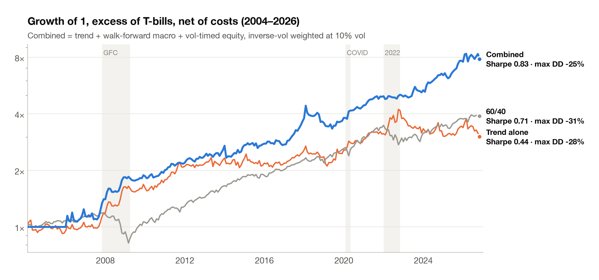
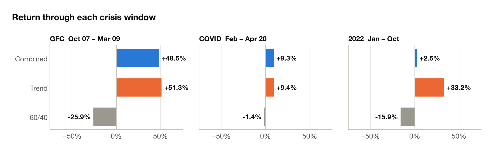
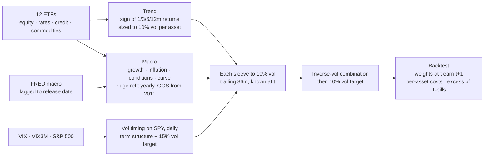
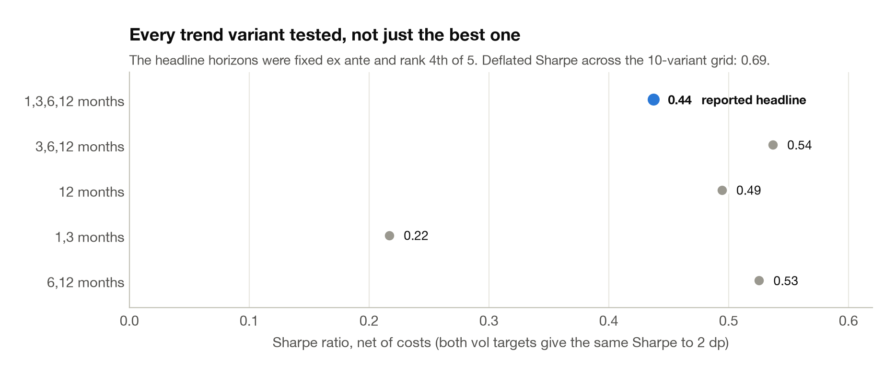

# 01 · Signal research

> **Question.** Do trend, macro and volatility signals add value out of sample, after costs?
>
> **Answer.** Not one by one, but together, yes. Three nearly uncorrelated sleeves combine to a
> Sharpe of **0.83** against **0.71** for 60/40, with a shallower worst drawdown (**−25%** vs
> **−31%**). The combination made **+48.5% through the GFC**, when 60/40 lost 26%.

<picture>
  <source media="(prefers-color-scheme: dark)" srcset="../figures/01_signals_growth_dark.png">
  
</picture>

## Three findings

1. **Diversification across signal types is the edge.** The sleeves' pairwise correlations are all
   below 0.15 in absolute value. That is how the combination (0.83) nearly doubles the best single
   sleeve (trend, 0.44).
2. **Trend is crisis insurance that pays to hold.** It made +51% in the GFC and +33% in 2022,
   when stocks and bonds fell together. Its standalone Sharpe is modest, and it survives costs:
   0.48 gross, 0.44 net, about 49 bps a year of drag.
3. **Fitting the macro model beat hand-setting it, but not when the regime broke.** The
   walk-forward ridge earned a Sharpe of 0.30 out of sample from 2011. It lost 10% in 2022, when
   the stock-bond correlation flipped sign.

<picture>
  <source media="(prefers-color-scheme: dark)" srcset="../figures/01_signals_crisis_dark.png">
  
</picture>

## How it works



| Sleeve | How positions are set | Kept out of sample by |
|---|---|---|
| **Trend** (TSMOM) | Average sign of trailing 1/3/6/12-month returns, × 10% ÷ EWMA vol, ÷ √N assets | No fitting; horizons taken from the literature (Moskowitz, Ooi & Pedersen 2012) |
| **Macro, fixed prior** | Four FRED states as 3-month changes, z-scored on an expanding window, × a hand-set sensitivity matrix | Matrix written before any backtest |
| **Macro, walk-forward ridge** | Per-asset ridge regression of next-month return on the same states | Expanding window, refit every 12 months, first prediction January 2011 |
| **Vol timing** | VIX/VIX3M scales exposure from 100% at 1.0 down to zero at 1.10, averaged with a 15% vol target | Thresholds fixed ex ante |

Macro data are lagged to their release dates: industrial production and CPI by one month. The
model never sees a number before the market did.

## Results

Monthly, 2004–2026, net of costs, in excess of 3-month T-bills.

| Sleeve | Sharpe | Max DD | GFC | COVID | 2022 |
|---|---:|---:|---:|---:|---:|
| Trend, 1/3/6/12m | 0.44 | −28% | +51.3% | +9.4% | +33.2% |
| Macro, fixed prior | 0.09 | −22% | +22.7% | +2.8% | +12.8% |
| Macro, walk-forward ridge (2011+) | 0.30 | −15% | n/a | +9.0% | −10.0% |
| **Combined** | **0.83** | **−25%** | **+48.5%** | **+9.3%** | **+2.5%** |
| 60/40 benchmark | 0.71 | −31% | −25.9% | −1.4% | −15.9% |

**Volatility timing on SPY** (daily, December 2007 onwards): the VIX term structure plus a 15% vol
target gave a Sharpe of **0.68** against 0.56 for buy-and-hold, and cut the maximum drawdown from
**−55% to −37%**.

## Honest selection

<picture>
  <source media="(prefers-color-scheme: dark)" srcset="../figures/01_trend_grid_dark.png">
  
</picture>

All ten trend variants (five horizon sets × two vol targets) are published in
[`trend_parameter_grid.csv`](../results/01_signals/trend_parameter_grid.csv). The reported
1/3/6/12-month version was fixed in advance, and three other horizon sets beat it. The **deflated
Sharpe ratio** (Bailey & López de Prado) corrects for the ten tries, skew and fat tails. It puts the
probability that trend has real skill at **69%**, short of the 95% bar. On 23 years of 12 ETFs,
trend's case rests on crisis convexity, not on its standalone Sharpe.

## What didn't work

- **The hand-set macro prior** earned a Sharpe of 0.09: sensible economic signs are not enough.
- **The fitted macro model lost money in 2022.** It had learned a world where bonds hedge equities.
- **Start-up periods count against the combination.** It sits in cash until 2006 while it builds
  24 months of trailing volatility, and the macro sleeve joins only in 2011. Both periods are
  included in every statistic above.

## Reproduce

```bash
python scripts/01_signal_research.py
```

Writes to [`results/01_signals/`](../results/01_signals): summary tables, crisis returns, cost impact,
sleeve correlations, the trend grid and the latest signal readings.

**Code:** [`signals/trend.py`](../quantlab/signals/trend.py) ·
[`signals/macro.py`](../quantlab/signals/macro.py) ·
[`signals/volatility.py`](../quantlab/signals/volatility.py) ·
[`core/backtest.py`](../quantlab/core/backtest.py) ·
[`core/metrics.py`](../quantlab/core/metrics.py)

[← All projects](../README.md) · [02 Risk premia →](../02-risk-premia)
