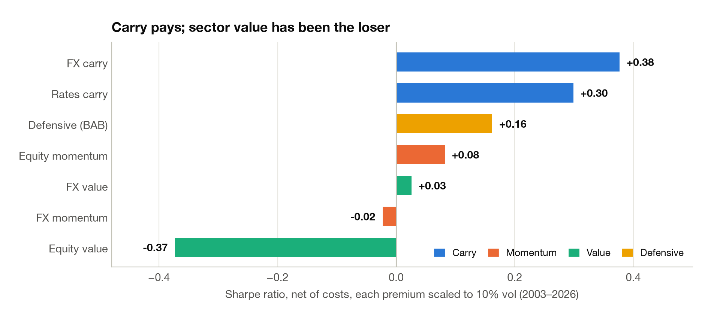
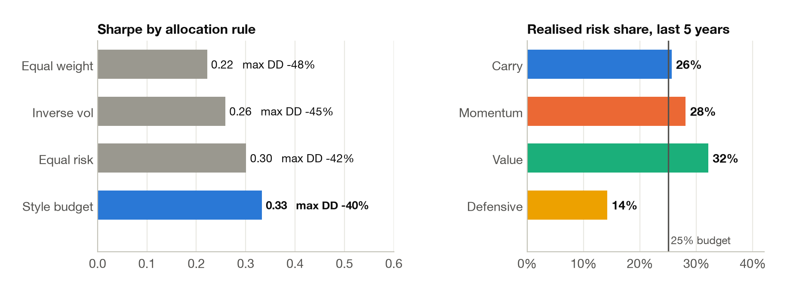
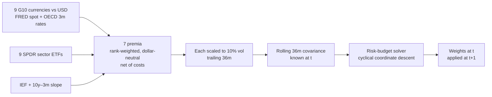
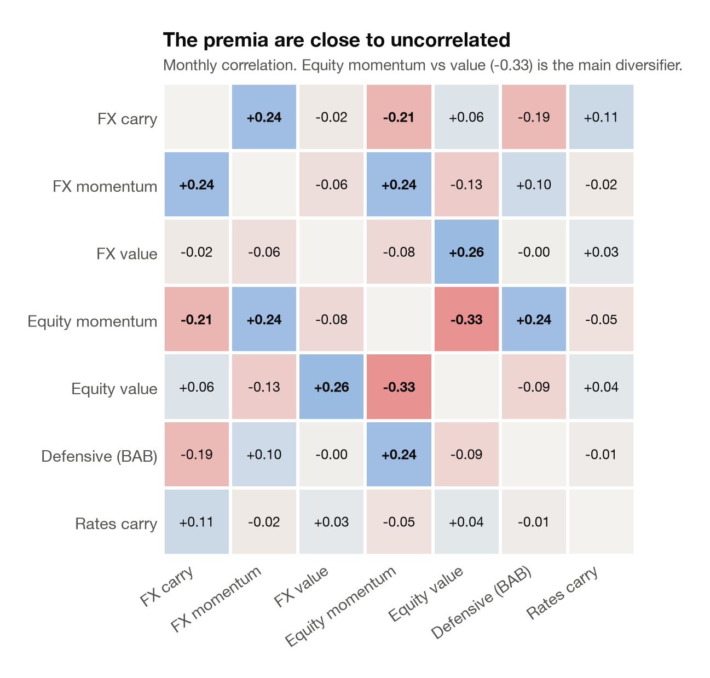

# 02 · Risk premia toolkit

> **Question.** Which alternative risk premia, the "everywhere" styles of carry, momentum, value and
> defensive, are worth risk when built from cheap public instruments? And how should you budget
> across them?
>
> **Answer.** **Carry does the work**: FX carry (Sharpe 0.38) and rates carry (0.30). Sector value
> was the clear loser (−0.37). Budgeting risk **equally by style**, rather than by return stream,
> gave the best portfolio: Sharpe **0.33** and max drawdown **−40%**, against 0.22 and −48% for
> equal weight.

<picture>
  <source media="(prefers-color-scheme: dark)" srcset="../figures/02_premia_sharpe_dark.png">
  
</picture>

## Three findings

1. **Over 2003–2026, most simple premia you can implement with ETFs have been weak.** Five of the
   seven have Sharpe ratios below 0.2. Carry is the exception, in both FX and rates.
2. **Budget by style, not by stream.** Momentum and value hedge each other: their correlation in
   equities is −0.33. Equal risk per *style* gives more weight to that hedge than equal risk per
   stream. Sharpe rises from 0.22 (equal weight) to 0.26 (inverse vol), 0.30 (equal risk) and
   0.33 (style budget), and each step also cuts the drawdown.
3. **An ex-ante budget does not hold ex post.** Over the last five years, realised risk by style
   ran 26 / 28 / 32 / 14% (carry / momentum / value / defensive) against a 25% target, so value
   took more risk than planned. The dashboard tracks this drift.

<picture>
  <source media="(prefers-color-scheme: dark)" srcset="../figures/02_premia_allocation_dark.png">
  
</picture>

## How it works



| Premium | Universe | Signal | Long / short |
|---|---|---|---|
| **FX carry** | 9 G10 vs USD | 3-month rate differential, lagged one month for OECD publication | High-yielders / low-yielders |
| **FX momentum** | 9 G10 vs USD | 12-month total return (carry included), skipping the last month | Winners / losers |
| **FX value** | 9 G10 vs USD | 5-year spot reversal, skipping the last year | Cheapest / richest |
| **Equity momentum** | 9 US sectors | 12-month return, skipping the last month | Winners / losers |
| **Equity value** | 9 US sectors | 5-year price reversal, skipping the last year | Cheapest / richest |
| **Defensive** (betting against beta) | 9 US sectors | Frazzini–Pedersen beta, shrunk 40% toward 1 | Low beta / high beta, each leg levered to beta 1 |
| **Rates carry** | IEF | z-score of the 10y–3m slope | Duration when the curve is steep |

Cross-sectional premia use rank weights: 100% long and 100% short, summing to zero (enforced by a
unit test). Allocation rules: equal weight, inverse volatility, equal risk contribution, and a
**style budget** that gives 25% of risk to each style, split equally between its streams. The
solver uses the convex formulation of Griveau-Billion, Richard & Roncalli (2013). A unit test checks
that it hits an arbitrary budget to 1e-6.

## Results

Each premium is scaled to 10% volatility and net of its own trading costs: 3 bps for FX, 1–2 bps
for ETFs. Premia run 2003–2026; allocations start in 2006, once 36 months of covariance exist.

| Allocation | Sharpe | Max DD | GFC | COVID | 2022 |
|---|---:|---:|---:|---:|---:|
| Equal weight | 0.22 | −48% | +20.3% | −16.8% | +30.8% |
| Inverse vol | 0.26 | −45% | +23.9% | −13.7% | +29.4% |
| Equal risk contribution | 0.30 | −42% | +32.3% | −8.7% | +29.4% |
| **Style budget, 25% each** | **0.33** | **−40%** | **+32.4%** | **−8.2%** | **+28.3%** |

<picture>
  <source media="(prefers-color-scheme: dark)" srcset="../figures/02_premia_correlation_dark.png">
  
</picture>

## What didn't work

- **Sector value** lost at a Sharpe of −0.37, with a −69% drawdown: the worst result in the
  project.
- **FX momentum and FX value** were flat (−0.02 and +0.03).
- **FX carry crashes with risk assets:** −23% in the GFC and −14% in COVID. Its Sharpe is real,
  and so is its left tail.
- **Rebalancing between premia isn't costed.** Each premium is net of its own trading, but moving
  weights between premia is not charged.

## Reproduce

```bash
python scripts/02_risk_premia.py
```

Writes to [`results/02_premia/`](../results/02_premia): premium and portfolio returns, summary tables,
correlations, crisis returns, and the latest weights with their risk contributions.

**Code:** [`premia/factors.py`](../quantlab/premia/factors.py) (premia, betas, risk-budget solver) ·
[`core/backtest.py`](../quantlab/core/backtest.py) ·
[`core/universe.py`](../quantlab/core/universe.py) (instruments, FRED ids, costs)

[← 01 Signal research](../01-signal-research) · [All projects](../README.md) · [03 Options overlays →](../03-options-overlays)
