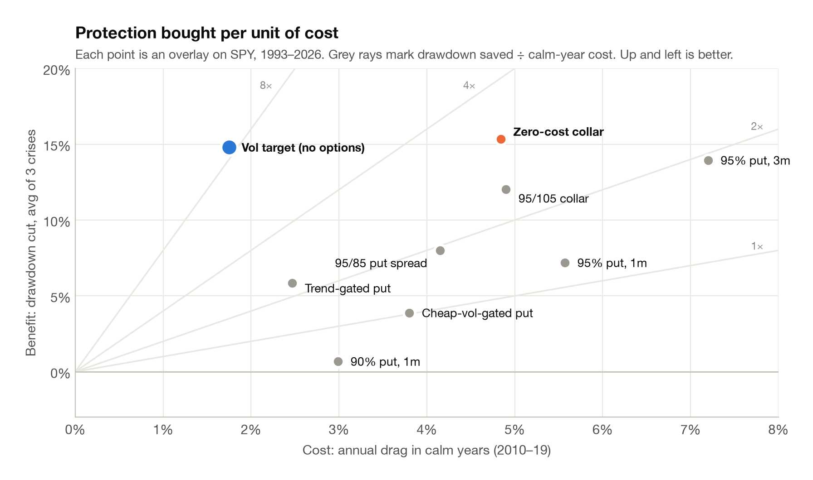
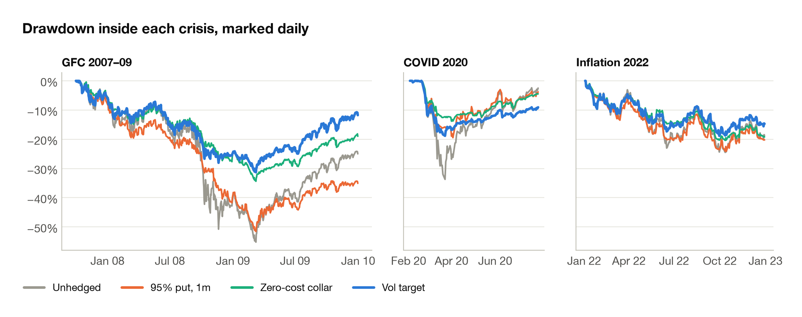
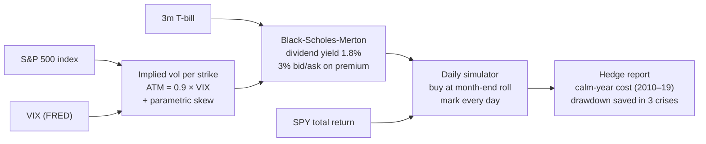

# 03 · Options overlays

> **Question.** What does crash protection on an equity portfolio cost in calm years, against the
> drawdown it saves in 2008, 2020 and 2022?
>
> **Answer.** **Rolling 1-month puts made the worst drawdown deeper** (−62% vs −55% unhedged) and
> cost 5.6% a year in calm markets. A **vol-target overlay with no options** saved the most
> drawdown per unit of cost: **8.5×**, against 1.3× for puts and 3.2× for the best option
> structure, a zero-cost collar.

<picture>
  <source media="(prefers-color-scheme: dark)" srcset="../figures/03_overlay_frontier_dark.png">
  
</picture>

## Three findings

1. **Puts pay in gap crashes, not slow ones.** The 1-month 95% put saved 18 points of drawdown in
   COVID, 4 in the GFC and nothing in the rates-led sell-off of 2022. Premium paid through the
   2000–02 bear market, then re-striking with the VIX near 60 in late 2008, left the hedged book
   with a deeper worst drawdown than no hedge at all.
2. **Paying for puts with calls, or gating them with trend, roughly doubles efficiency.** The
   zero-cost collar saved 3.2× its cost and the trend-gated put 2.4×, against 1.3× for the plain
   put.
3. **The cheapest protection is cutting exposure when volatility rises.** Scaling SPY to 15%
   forecast volatility (at most 100% invested) saved 24 points in the GFC and 15 in COVID for
   1.8% a year. Holding the worst crisis drawdown to −45% with puts instead takes 75% notional
   in at-the-money 1-month puts, at 8.4% a year.

<picture>
  <source media="(prefers-color-scheme: dark)" srcset="../figures/03_overlay_episodes_dark.png">
  
</picture>

## How it works



Historical option chains aren't free, so options are **priced from the VIX with a parametric
skew**. With moneyness *k* = ln(K/F):

```
put  (k < 0):  σ = 0.9 · VIX · (1 − 4.5 · k)
call (k > 0):  σ = max(0.9 · VIX · (1 − 2.0 · k),  0.54 · VIX)
```

At an at-the-money vol of 15%, a 1-month 95% put prices about 3.5 vol points higher, in line with
typical S&P skew. The book is marked to model every day, so drawdowns inside a month are counted,
not just month-end snapshots. **Cost** is the gap in annual return against unhedged SPY over
2010–19. **Drawdown saved** is measured peak to trough inside each crisis window: GFC 9 Oct 2007 –
9 Mar 2009, COVID 19 Feb – 23 Mar 2020, 2022 from 3 Jan to 12 Oct.

## Results

SPY, daily, 1993–2026. Savings are in percentage points of drawdown.

| Overlay | CAGR | Max DD | Calm-year cost | Saved: GFC / COVID / 2022 | Saved ÷ cost |
|---|---:|---:|---:|---:|---:|
| Unhedged SPY | 10.8% | −55% | n/a | n/a | n/a |
| 95% put, 1m | 4.6% | −62% | 5.6% | 4 / 18 / 0 | 1.3× |
| 90% put, 1m | 6.5% | −66% | 3.0% | −4 / 11 / −5 | 0.2× |
| 95% put, 3m | 3.9% | −55% | 7.2% | 16 / 24 / 1 | 1.9× |
| 95/85 put spread | 7.3% | −49% | 4.2% | 10 / 11 / 3 | 1.9× |
| 95/105 collar | 6.3% | −46% | 4.9% | 14 / 20 / 2 | 2.5× |
| Zero-cost collar, 95% put | 6.2% | −42% | 4.8% | 21 / 21 / 4 | 3.2× |
| Trend-gated 95% put | 8.8% | −52% | 2.5% | 4 / 15 / −1 | 2.4× |
| Cheap-vol-gated 95% put, 3m | 8.9% | −45% | 3.8% | 10 / 0 / 1 | 1.0× |
| **Vol target, no options** | **9.6%** | **−41%** | **1.8%** | **24 / 15 / 6** | **8.5×** |

Trend gate: hedge only when the S&P is below its 210-day average at the roll. Cheap-vol gate:
hedge only when the VIX is below its one-year median.

**Skew is the key assumption, so it is stressed.** Scaling the skew by ×0.7 / ×1.0 / ×1.3 moves the
95% put's calm-year cost to 4.6% / 5.6% / 6.6% and its maximum drawdown to −57% / −62% / −67%.
The COVID saving holds at about 17–18 points throughout, so the conclusions don't depend on the
skew estimate.

**Dated snapshot (26 October 2026, VIX 19.45).** The model prices a 1-month 95% S&P put at 0.67% of
spot, about 8% a year if rolled. The full sizing grid (strike × hedge ratio against drawdown
target) is in [`put_sizing_grid.csv`](../results/03_overlays/put_sizing_grid.csv).

## What didn't work

- **Out-of-the-money 1-month puts** (90%) made drawdowns worse in both the GFC and 2022.
- **Buying protection only when it is cheap** saved nothing in COVID: no hedge was on when the crash
  came, and the drawdown matched unhedged SPY exactly.
- **Nothing here is a traded quote:** there is no early exercise, no dividend timing and no real
  skew history. Read the levels as model-relative, not as broker prices.

## Reproduce

```bash
python scripts/03_options_overlays.py
```

Writes to [`results/03_overlays/`](../results/03_overlays): daily overlay returns, the hedge report,
the sizing grid, the skew stress and today's model quotes.

**Code:** [`overlays/options.py`](../quantlab/overlays/options.py) (pricing, skew, simulator, hedge
report) · [`signals/volatility.py`](../quantlab/signals/volatility.py) (vol target) ·
[`tests/test_core.py`](../tests/test_core.py) (put-call parity, skew sign)

[← 02 Risk premia](../02-risk-premia) · [All projects](../README.md) · [04 LLM analyst dashboard →](../04-llm-analyst-dashboard)
