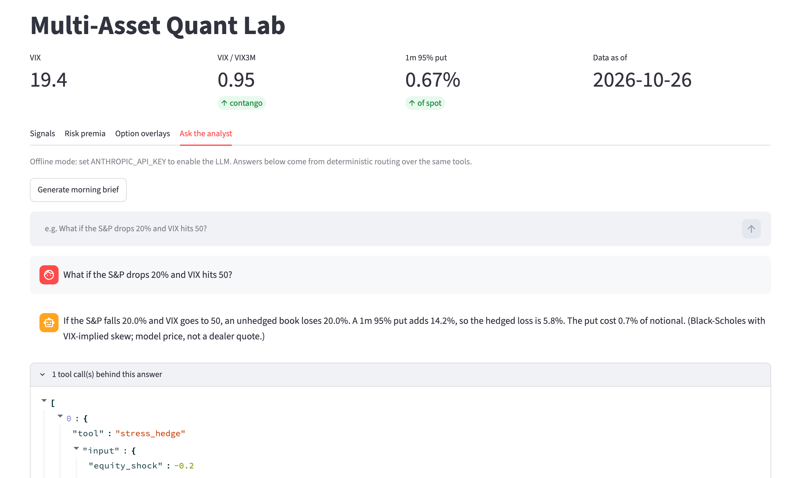
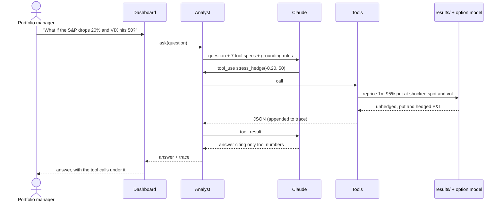
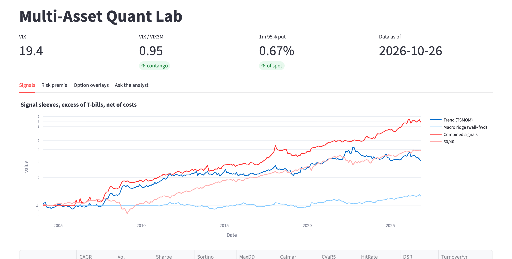

# 04 · LLM analyst dashboard

> **Question.** Can an LLM sit on top of quantitative research and answer a portfolio manager's
> questions without inventing numbers?
>
> **Answer.** Yes, if it can only speak through tools. The analyst gets **7 tools** that read the
> same result files the dashboard shows or reprice options live. Its instructions forbid any number
> that didn't come back from a tool, and **every answer carries its tool trace** so it can be checked
> line by line. Without an API key it falls back to deterministic routing over the same tools, so
> the dashboard never breaks and the grounding can be tested.



<sub>Screenshot of the running dashboard in offline mode (no API key), data as of 26 October 2026.</sub>

## Three design choices

1. **Grounding.** Tools are the only route to data. Each one returns plain JSON from
   [`results/`](../results) or from the option model used in the backtests. The model never sees
   raw files.
2. **Auditability.** Every tool call and its output are kept in a trace and shown under each
   answer, so a reader can check any figure against its source.
3. **Graceful degradation.** With no key, a deterministic router answers from the same tools. The
   dashboard works anywhere, and tests can check that the answer's numbers match the tool output.



## The tools

| Tool | Returns |
|---|---|
| `list_strategies` | Every strategy name across the three studies |
| `get_performance` | CAGR, vol, Sharpe, drawdown and costs for any strategy (case-insensitive name match) |
| `get_latest_signals` | Current trend scores, macro z-scores, VIX term structure, vol-timing exposure |
| `get_premia_allocation` | Current risk-budget weights and realised risk contributions |
| `get_hedge_quotes` | Today's model prices for 1-month S&P puts, and the cheapest put programme per drawdown target |
| `get_crisis_performance` | Every strategy's return and drawdown in the GFC, COVID and 2022 |
| `stress_hedge` | Reprices a put under any equity and VIX shock, using the backtests' pricing model |

## Real exchanges

These are offline-mode answers, produced by the deterministic router from the committed results on
26 October 2026:

> **Q.** What if the S&P drops 20% and VIX hits 50?
> **A.** If the S&P falls 20.0% and VIX goes to 50, an unhedged book loses 20.0%. A 1m 95% put adds
> 14.2%, so the hedged loss is 5.8%. The put cost 0.7% of notional. *(Black-Scholes with
> VIX-implied skew; model price, not a dealer quote.)*  · tools: `stress_hedge`

> **Q.** What does a put cost today?
> **A.** As of 2026-10-26 (VIX 19.4), a 1m 95% S&P put costs 0.7% of spot, about 8.1% a year if
> rolled. In the backtest the zero-cost 95% collar cut the worst drawdown to −41.5% with a
> calm-year cost of 4.8%.  · tools: `get_hedge_quotes`, `get_performance`

## The dashboard

`streamlit run dashboard/app.py` opens four tabs on the committed results: **Signals**, **Risk
premia**, **Option overlays** (with a live scenario repricer: pick an S&P move, a VIX level and a
strike), and **Ask the analyst**, which also writes a morning brief.



## Tested

[`tests/test_analyst.py`](../tests/test_analyst.py) checks that the tool specs are well formed. It
checks that every percentage in a stress answer appears in that answer's tool output, and that
every routed question leaves a trace.

**Not shown here:** the Claude path needs `ANTHROPIC_API_KEY`. The screenshots and exchanges above
come from offline mode. With a key, the same tools and trace sit behind a tool-use loop of up to
six turns.

## Run it

```bash
export ANTHROPIC_API_KEY=...            # optional: switch the analyst to Claude
export QUANTLAB_MODEL=claude-sonnet-5-5 # optional: default shown
streamlit run dashboard/app.py
```

**Code:** [`llm/analyst.py`](../quantlab/llm/analyst.py) (tool-use loop, system prompt, offline
router) · [`llm/tools.py`](../quantlab/llm/tools.py) (the 7 tools and their schemas) ·
[`dashboard/app.py`](../dashboard/app.py)

[← 03 Options overlays](../03-options-overlays) · [All projects](../README.md)
