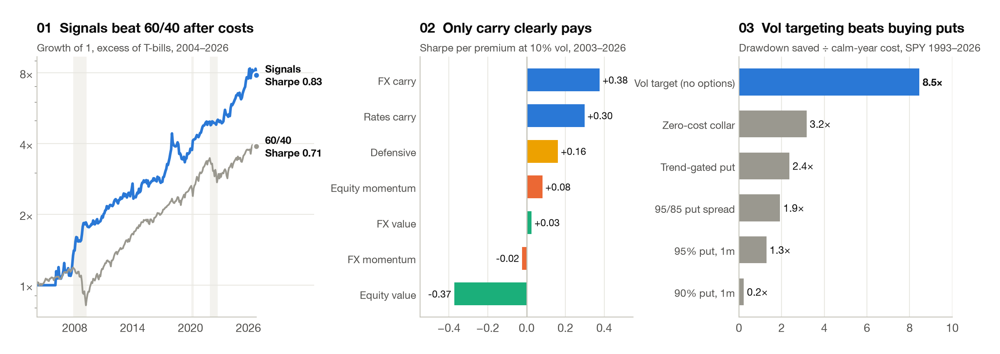
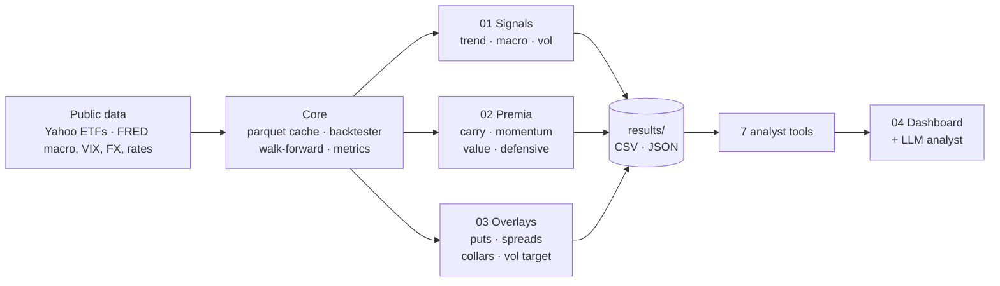

# Multi-Asset Quant Lab

**Three questions every multi-asset portfolio manager has to answer: which signals survive costs,
which risk premia are worth the risk, and what crash protection really costs. Plus a fourth project
that puts an LLM analyst on top of the research, one that can only quote numbers the research
produced.**

Public data only (Yahoo Finance ETFs, FRED) · one look-ahead-proof backtester · 11 tests ·
backtests 1993–2026 · results snapshot dated 26 October 2026

<picture>
  <source media="(prefers-color-scheme: dark)" srcset="figures/overview_dark.png">
  
</picture>

## The answers

| | Project | Question | Answer |
|---|---|---|---|
| 01 | [**Signal research**](01-signal-research) | Do trend, macro and volatility signals add value out of sample, after costs? | **As a combination, yes.** Sharpe 0.83 vs 0.71 for 60/40, max drawdown −25% vs −31%, and **+48.5% through the GFC** while 60/40 lost 26%. No single signal gets there alone. |
| 02 | [**Risk premia toolkit**](02-risk-premia) | Which alternative premia are worth risk, and how should you budget across them? | **Carry does the work** (FX 0.38, rates 0.30 Sharpe); sector value lost (−0.37). Budgeting risk **by style**, not by stream, gave the best mix: Sharpe 0.33 and max drawdown −40%, vs 0.22 and −48% for equal weight. |
| 03 | [**Options overlays**](03-options-overlays) | What does crash protection cost in calm years, against what it saves in 2008, 2020 and 2022? | **Rolling puts made the worst drawdown deeper** (−62% vs −55%). A vol-target overlay with no options saved 8.5× its cost in drawdown; rolling puts saved 1.3×. Puts pay only in gap crashes like COVID. |
| 04 | [**LLM analyst dashboard**](04-llm-analyst-dashboard) | Can an LLM sit on top of the research without inventing numbers? | **Yes, if it can only speak through tools.** It has 7 tools over the same result files, an audit trace under every answer, and an offline mode that keeps the dashboard working and testable. |

## How the work protects itself

- **No look-ahead by construction.** Weights decided at the close of *t* earn the return of *t+1*, and macro data is lagged to its release date. A unit test enforces it.
- **Net of costs, in excess of cash.** Each asset pays one-way costs of 1–5 bps on drift-adjusted turnover, and options pay 3% of premium. ETFs are financed at T-bill rates, so they behave like futures.
- **Honest selection.** Parameters are fixed in advance or fitted walk-forward. The full trend grid is published, and the headline is scored with a deflated Sharpe ratio.
- **Failures are reported, not dropped.** A hand-set macro model (Sharpe 0.09), sector value (−0.37) and rolling puts all lost money, and the project pages show it.



## Run it

```bash
git clone https://github.com/ambekarhrush/multi-asset-quant-lab.git && cd multi-asset-quant-lab
python3 -m venv .venv && source .venv/bin/activate && pip install -r requirements.txt
streamlit run dashboard/app.py       # opens straight away on the committed results
./run_all.sh                         # re-download data, rerun all three studies, tests, figures (~1 min)
```

Set `ANTHROPIC_API_KEY` to switch the analyst from offline routing to Claude. The model is set by
`QUANTLAB_MODEL` and defaults to `claude-sonnet-5-5`. A rerun downloads current data. On 26 October
2026 a fresh run left signals and overlays unchanged to two decimal places and moved premia Sharpe
ratios by up to 0.01, because of FRED revisions.

## Repository

```
01-signal-research/ … 04-llm-analyst-dashboard/   one page per project
quantlab/core        data loaders + cache, backtester, walk-forward, metrics (incl. deflated Sharpe)
quantlab/signals     trend, macro (fixed prior + walk-forward ridge), volatility signals
quantlab/premia      FX / sector / rates premia, beta estimation, risk-budget solver
quantlab/overlays    Black-Scholes with VIX skew, daily overlay simulator, hedge analytics
quantlab/llm         tool layer + analyst
dashboard/           Streamlit app
scripts/             one script per study, plus the HTML report and these figures
results/             every number quoted on these pages, as CSV / JSON
tests/               look-ahead, costs, put-call parity, solver, metrics, analyst grounding
```

**Limits.** About 22 years of ETF history covering three real crises. Short ETF positions stand in
for futures. Options are model-priced from the VIX with a parametric skew, not traded quotes. This
is backtested research, not a live track record.

---

Hrush Ambekar · research on public data only
